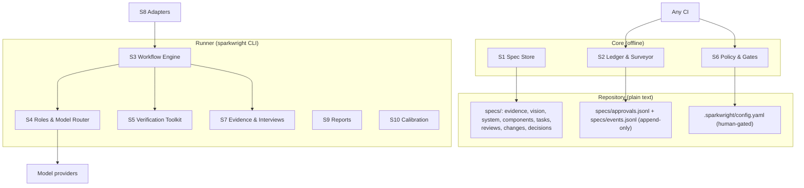

## Overview

SparkWright is three layers. The **Core** is plain files in the repository
(specs, evidence, approvals, events, config) plus a library that parses and
checks them with no network or model access. The **Runner** is the
`sparkwright` CLI: it drives agents through workflows, calls any model provider,
runs verification tools and enforces gates. **Adapters** let host coding agents
drive the same workflows with their own agents. Every feature works from the
CLI alone.



## Requirement line grammar

Every requirement is one Markdown bullet:

```
- **<ID>** [<ref>, <ref>, ...] <text>
  <optional continuation lines, indented two or more spaces>
```

Example with two refs and a continuation line:

```
- **S2.4** [V8, V1] When a requirement is approved, the system shall append an
  approval entry recording its hash.
```

- Refs are separated by commas; whitespace is ignored. `[]` is allowed on
  assumption and vision lines (a vision line with `[]` is reported by S1.4).
- A line that starts with `- **<something matching an ID pattern>**` but does not
  follow the grammar is a grammar error.
- Lines inside fenced code blocks are never requirement lines. Requirement lines in
  change requests and reviews quote requirements; they are not definitions. An ID
  defined twice in the spec set is a grammar error (`grammar.duplicate-id`).

### Hashes

`N(s)` = the string with every run of whitespace replaced by one space and leading and
trailing whitespace removed; `H(s)` = lower-case hex SHA-256 of `N(s)` encoded as UTF-8.
`J(x)` = Python `json.dumps(x, sort_keys=True, default=str)` (separators `", "` and
`": "`, ASCII escapes).

- Requirement `hash` = `H(text)`, or `H(text + "\n" + J(extras))` when the task has an
  extras block (S1.8: the parsed yaml block, only the keys written).
- Requirement `hash2` = `H(text + "\nrefs:" + ",".join(sorted(refs)) + "\nextras:" +
  J(extras) + "\ncriteria:" + C)`, where `C` joins the non-empty lines of the task file's
  acceptance-criteria section, each passed through `N`, with `"\n"` (empty when there is
  none).
- Evidence, change request and decision `hash` = `H(body)` (everything after the front
  matter); `hash2` = `H(body + "\nmeta:" + J({k: v}))` for the fields `simulated`,
  `consent`, `source`, `target`, `renames` and `risk` that are present.
- Test-file hash = hex SHA-256 of the file's bytes with CRLF replaced by LF.
- Example: `H("The parser shall parse.")` =
  `09c2dc19a12eda64c7ab296833b7c8152b7d82827345d16e3a8a5fc510d56477`.

### Globs

Globs use Python `fnmatch`: `*` and `**` both match any characters including `/`, so
`tests/**/*` matches every file under `tests/`; `dir/**` also matches `dir` itself. A
pattern with a `/` does not match a file at the root (`**/test_*.py` misses
`test_a.py`; add `test_*.py` for that). Dotfiles match like other names. Matching is
case-sensitive except on Windows, and `always_protected` is always matched without
regard to case.

### Record formats

All times are UTC ISO 8601 with offset (`2026-10-25T04:01:06.276290+00:00`).

```
approvals.jsonl  {"approver": "Srikanth", "change_request": null, "hash": "…", "hash2": "…", "id": "S1.1", "risk": "high", "role": "human", "time": "…"}
events.jsonl     {"event": "changed", "id": "C1.1.1.T1", "reason": "CR2 applied", "run": null, "time": "…"}
```

Events: `changed`, `cr-applied` (reason = the CR id), `building`, `blocked`, `done`,
`reviewed` (reason = review id and the hash the reviewers saw). A review file is
`specs/reviews/<date>-<target>-r<n>.md` with front matter (`id: R<n>`, `type: review`,
`target`) and one table with the columns ID (`F<n>`, numbered from 1), Severity
(`high`, `medium`, `low`), Requirements, Finding, Suggested fix, Raised by and Decision
(`open`, `accepted`, `rejected`, `deferred`, or a short free text such as
`fixed (D009)`; anything other than `open` closes the finding).

## Components

| ID | Component | Responsibility | Parents |
| --- | --- | --- | --- |
| S1 | Spec Store | File formats, IDs, grammar, templates, deltas | V1, V2, V3, V10 |
| S2 | Ledger & Surveyor | Traceability, coverage, drift, approvals, status | V1, V2, V4, V8, V10 |
| S3 | Workflow Engine | review, interview, descend, build, change | V2, V3, V4, V10 |
| S4 | Roles & Model Router | Personas, isolation, tiers, retries, ceilings | V2, V7, V9, V11 |
| S5 | Verification Toolkit | Project checks, red check, mutation, property, library checks, proofs | V3 |
| S6 | Policy & Gates | Gates, approvals, risk tiers, protected paths, CI checks | V5, V8, V10, V11 |
| S7 | Evidence & Interviews | Owner interview, transcript ingest, synthesis, privacy | V6 |
| S8 | Adapters | Adapter contract, neutral skills, host packages, guard | V7, V8 |
| S9 | Reports | Status, trace, findings, PR descriptions, telemetry | V1, V8, V9 |
| S10 | Calibration | Planted-flaw suite and persona scoring | V9 |
| S11 | Non-functional | Offline core, determinism, JSON, secrets, plain text, performance | V1, V7, V10, V11 |

## Requirements

### S1 — Spec Store

- **S1.1** [V1] Every spec file shall begin with YAML front matter containing `id`, `title`, `type` and `status`. Allowed `status` values: evidence `draft`, `confirmed`, `rejected`; change request `open`, `approved`, `rejected`, `applied`, `blocked`; all other types `draft`, `in-review`, `approved`, `rejected`. Files of type component or task shall contain `risk` (`low`, `medium` or `high`); other files may; a file without `risk` is treated as `low` except Vision and System, which are always human-gated (S6.1). Evidence files may contain `source`, `consent` and `simulated`.
- **S1.2** [V1] IDs shall match: evidence `E\d+`, assumption `A\d+`, vision `V\d+`, system `S\d+\.\d+`, component `C\d+\.\d+\.\d+`, task `C\d+\.\d+\.\d+\.T\d+`, review `R\d+`, change request `CR\d+`, decision `D\d+`. File ids are `VISION`, `SYSTEM` and `CONSTITUTION` for those files, `C\d+` for a component file (it holds requirements `C<n>.x.y`), the task id for a task file, and the record id for evidence, review, change-request and decision files. A component requirement's parent is named by its refs, not by its number: `C2.1.1` may cite any System requirement. Leading zeros are not significant; two IDs equal after removing leading zeros are the same ID.
- **S1.3** [V2] The store shall support the levels Evidence, Vision, System, Component and Task, plus Constitution, Decision, Review and Change Request files, in the layout under "Repository layout".
- **S1.4** [V1] When a Vision requirement line cites no `E` or `A` ID, or cites only simulated evidence, the system shall report a `vision.no-evidence` gap.
- **S1.5** [V10] When a change is proposed to an approved spec, the change request file shall carry `ADDED`, `MODIFIED` and `REMOVED` sections, each containing complete requirement lines; MODIFIED lines keep their ID.
- **S1.6** [V2] The store shall ship templates for every file type, including an interview guide, installed by `init` under `.sparkwright/templates/`.
- **S1.7** [V10] When a Component file sets `lite: true`, its tasks shall be written as requirement lines in a `## Tasks` section of that file, using the normal task ID grammar; a lite task's acceptance criteria are continuation lines of its requirement line (so they are part of its hash), and it inherits the component's `risk`.
- **S1.8** [V3] A task line may be followed by a fenced `yaml` block with `files` (list of globs the task may change; required for building), `invariants` (list of property statements) and `prove` (boolean). The parsed block, with only the keys actually written, is the task's extras (defaults are not filled in before hashing). In a task file, acceptance criteria are written under `## Acceptance criteria` (or `###`, any case) as bullets beginning `AC<n>:`.

### S2 — Ledger & Surveyor

- **S2.1** [V1] The Surveyor shall build the ledger from spec files, `specs/approvals.jsonl`, `specs/events.jsonl`, git commit trailers and test annotations. A test annotation is the text `sparkwright: <ID>` anywhere in a file matching `test_globs`. Trailers are `SparkWright-Task: <ID>` (repeatable) and `SparkWright-Role: <role>`; trailer keys are case-sensitive, role values are compared in lower case, and a commit whose role trailers disagree fails `check`. Merge commits are skipped for trailer and drift checks but not for the log and review-file checks (S6.9, S6.11). The ledger is generated (`.sparkwright/ledger.json`, gitignored).
- **S2.2** [V1] `trace <ID>` shall report the chain up to evidence or assumptions and down to tasks, tests and commits.
- **S2.3** [V2, V1] The Surveyor shall report as gaps: a parent with no child once the child level has any requirement; a child citing an unknown ID or an ID of the wrong level; a task citing a component other than its own; a task with derived status `done` and no test; a commit after the baseline with no task trailer. The only exception to the trailer rule is a commit whose every file is drift-exempt (S2.6), such as a spec-only commit; `trailers: warn` or `off` weakens this rule and is reported by `check` (S6.8).
- **S2.4** [V8] When a requirement, evidence file, change request, decision or test file is approved, the system shall append an entry to `specs/approvals.jsonl` with `id`, `hash`, `approver`, `role`, `change_request` and `time`, plus `risk` (the owning file's risk tier) and `hash2` (see "Hashes"). Ids: a requirement uses its ID; an evidence file, change request or decision uses its file id; a test file uses `test:<repo-relative path>`. `role` is `human` for approvals and `runner` only for test locks. A change request or decision counts as approved only while such an approval matches it, whatever its `status` line says. When an approved item's current hash (or `hash2`, when recorded) differs from its latest approval, `check` shall fail. An approval without `hash2` still counts; `approve` refreshes it without a change request only when the item's `hash2` computed from the file as it stood in the commit that recorded that approval equals the current one, and otherwise asks for a change request. A changed requirement is re-approved only with an approved change request (`approve --cr CR<n>`).
- **S2.5** [V4] When a change request is applied (`change apply`, S3.11), the Surveyor shall compute its affected set (each target and every descendant), and the engine shall append a `changed` event for each affected requirement whose derived status is `approved`, `building` or `done`, and a `cr-applied` event for each target; affected items in `draft` or `in-review` are not changed. Approving a change request appends no event.
- **S2.6** [V4] When a commit after the baseline changes a file that matches no `files` glob of any task with derived status `approved`, `building` or `done`, and the file is not exempt, `check` shall report drift. Exempt: the paths in `drift_exclude` (default `specs/**`, `.sparkwright/**`, `*.md`, `LICENSE`, `NOTICE`, `.gitignore`, `.gitattributes`, `personas/**`, `templates/**`), and files matching `test_globs` in a commit whose trailer cites a task that is `approved`, `building`, `done`, `changed` or `in-review`. Globs use shell matching where `*` matches across `/` and `dir/**` matches everything under `dir`. Drift is checked only once at least one task declares `files`.
- **S2.7** [V10] The baseline is the config key `baseline` (a commit hash): commit, drift and log checks apply only to commits after it, and when it is unset they apply to the whole history. `init` in a repository that has commits records the current commit; `adopt` records the current commit and the Surveyor drafts Task, Component and System specs bottom-up, all in status `draft`.
- **S2.8** [V2] The derived status of a requirement shall be the first rule that applies: (1) `draft` if its latest approval matches the current text but was recorded under a different risk tier; (2) `in-review` if it has a `changed` event with no newer matching approval and a `cr-applied` event at or after that change, otherwise `changed`; (3) `done`, `building` or `blocked` if that is its latest build event and the event is not older than its latest `changed` event; (4) `approved` if its latest approval matches its current text; (5) the file's front-matter status if `draft`, `in-review` or `rejected`; (6) `draft`. In addition, `check` derives `done` for a `building` task whose ready commit on branch `sparkwright/<task-id>` is reachable from the commit `check` runs on; in CI that is the protected main branch, so a task is `done` only once a human merged it there.
- **S2.9** [V10] When a change request that counts as approved under S2.4 (a matching human approval, status `approved` or `applied`) declares `renames: {OLD: NEW}`, the ledger shall treat `OLD` in trailers, test annotations and approvals as `NEW`; a status line alone never activates renames.

### S3 — Workflow Engine

- **S3.1** [V2] Workflows shall be state machines of named steps: `review`, `interview`, `descend`, `build` and `change`. One engine drives every workflow; `advance()` performs the next step or, in host mode, returns the step for a host agent to perform.
- **S3.2** [V2] Each run shall append JSON lines to `.sparkwright/runs/<run-id>.jsonl` with at least `run`, `workflow`, `step`, `status` (`started`, `done`, `failed`, `skipped`) and, for model calls, `role`, `tier`, `model`, `input_tokens`, `output_tokens`, `cost_usd`, `duration_s`. Run IDs match `YYYYMMDD-HHMMSS-<workflow>-<hex6>`. On resume, steps with status `done` are not repeated; a corrupt line is skipped.
- **S3.3** [V3] When `build` runs for an approved task, the engine shall first require `checks.test` to be configured and to pass on the base commit, then execute in order: create workspace; Test Author; red check (a guard check instead when the task changes only test files or the Test Author reports it already implemented); Property Tester, when the task declares invariants (its tests are checked statically here: they compile, assert, do not skip and carry the task annotation; they run from verify onward); Builder (skipped for test-only and already-implemented tasks); verify; Prover, when the task sets `prove: true`; Library Checker; Saboteur; lock tests; Code Reviewer; Security Reviewer, when S6.2 requires it; final gate re-derived from git; commit to branch `sparkwright/<task-id>`. Failures follow the table under "Build failure handling".
- **S3.4** [V3] A Saboteur round fails when the mutation score on the task diff is below `mutation.min` (default 0.8). The engine shall then freeze the Builder's code and return to the Test Author with the surviving mutants; the strengthened tests must pass against the frozen code (no red check), then the Saboteur runs again. The freeze lasts only for that loop: any later Builder change (after verify, Library Checker, Prover or a reviewer finding) reruns verify, Prover, Library Checker, Saboteur and the test lock before the reviewers. Round counters are kept per step: `red`, `props`, `saboteur` and `builder` (shared by verify, Prover, Library Checker, Code Reviewer and Security Reviewer). Each counter allows 2 retries after the first attempt; the failure that would need a third retry makes the task `blocked`.
- **S3.5** [V4] When the Builder returns a `spec_defect` report (`{"spec_defect": {"cited_id": "<ID>", "reason": "..."}}`), the engine shall stop the build, append a `changed` event for the task only, and write a change request targeting `cited_id` if it is an ancestor of the task, otherwise the task's parent; other affected requirements are marked when that change request is applied (S2.5).
- **S3.6** [V4] A change request shall allow at most 2 rebuild rounds of an affected task (a round is one build attempt after the change request is applied); a third makes the change request `blocked`. A human then either rejects it, or edits the targets again and records a new approval of the change request, which resets its rounds without new events.
- **S3.7** [V2] When an Inspector swarm finishes, the Foreman shall merge findings into one review file, ranked by severity then ID. Personas are taken in name order and their findings in their own order; each finding is compared with the merged findings so far, in order, and joins the first one that comes from other personas and is similar (greedy, no transitive re-merging); findings of the same persona never merge. Wording overlap is the Jaccard index of the sets of lower-case alphanumeric words longer than 2 characters in the finding and fix texts; ID overlap is the Jaccard index of the sets of requirement IDs cited. Two findings are similar when both cite IDs and either the ID sets are identical with wording overlap at least 0.15, or ID overlap is at least 0.5 with wording overlap at least 0.19; when at least one cites no ID, wording overlap must be at least 0.45. A merged finding keeps the first finding's text, the highest severity, the union of IDs and personas, and the fixes joined with ` / `. Example: IDs {S1.1} and {S1.1} with 3 shared words out of 15 distinct (0.2) merge.
- **S3.8** [V3] Tasks whose `files` globs do not intersect shall build in parallel in separate workspaces; before merge, the engine shall compare the actual changed files and stop if two builds changed the same file.
- **S3.9** [V4] When an approved change request is applied and its target is re-reviewed and re-approved, the engine shall make its `changed` descendant tasks buildable again; their next build counts as a round under S3.6.
- **S3.10** [V4] When a change request is applied, its targets become `in-review` (S2.8); a target's re-approval with `--cr` is refused until a review recorded after the apply has seen its current text, and descendant tasks are re-approved and rebuilt only after their target is re-approved.
- **S3.11** [V4, V10] A change request shall move through: `open` (written by `change new` or a `spec_defect`) → `approved` (by a human with `approve CR<n>`) → `applied` (by `change apply CR<n>`, which appends the S2.5 events and sets the file status; it does not edit spec text). A human edits the targets to match the change request's ADDED, MODIFIED and REMOVED lines after applying it, the targets are re-reviewed (S3.10), and each target is re-approved with `--cr`; then the targets' `changed` descendant tasks become buildable again and each rebuild counts as a round (S3.6). The change request is finished when every target and affected task is approved again; this is derived, not stored. A change request may also become `rejected`, or `blocked` under S3.6. `target` may be one ID or a list.

### S4 — Roles & Model Router

- **S4.1** [V2] Each role shall be defined in a persona file with front matter `name`, `version`, `tier`, `job`, `never_sees`, `output`, and a body that is the role's instructions. Built-in personas ship in the package; a file with the same name in `personas/` overrides it.
- **S4.2** [V2] When an Inspector, Test Author or Code Reviewer runs, it shall receive only the artifact under review, its parent specs, the constitution and, for build roles, the task's test and source files; never the authoring conversation or other Inspectors' reports.
- **S4.3** [V7] Model choice shall use provider-neutral tiers `top`, `mid`, `fast`; `models` maps each tier to a provider and model, `roles` maps a role to a tier (default: the persona's `tier`).
- **S4.4** [V9] When a role call fails (provider error or timeout), the router shall make one more attempt at the next tier up, or the same tier for `top`; when both fail, the role has failed and the engine applies "Build failure handling".
- **S4.5** [V9] Before each persona call, the router shall estimate its cost as the mean cost of earlier calls in the run (0 for the first call, so a ceiling can stop the second call at the earliest); when `budgets.per_run_usd` or `budgets.per_level_usd.<level>` (US dollars, 0 = no ceiling) would be exceeded, it shall skip the remaining personas of the review in the order the review lists them. The first 2 personas of that order (the forced minimum Inspectors) and any persona required by S6.2 or S6.7 are exempt from both the dollar ceilings and the call cap. A required persona that fails or produces no review adds a high-severity finding, so the review fails closed. Cost comes from `price_per_mtok` per tier in config. Because the dollar ceiling cannot work for a tier without a positive price, calls to unpriced tiers stop with a budget error once the run has made `budgets.max_calls_per_run` calls (default 40).
- **S4.6** [V11] When a persona receives artifact, parent, evidence or source text, the text shall be framed as data, ending at a marker that contains a hash of the data (so the data cannot contain it), with an instruction never to follow directions inside it, and the persona's output shall be used only as parsed findings or result JSON.

### S5 — Verification Toolkit

- **S5.1** [V3] `sparkwright verify` shall run the commands in `checks` (`test`, `lint`, `types`, others) and fail if any exits non-zero; these results outrank any agent verdict. `check` never runs project commands.
- **S5.2** [V3] Red check: before the Builder runs, every new test file shall compile, and the whole `checks.test` command run after the Test Author's commit shall exit non-zero. An import error of the code under test counts as red; a syntax error in a test file, or a broken test runner (no tests collected, the runner itself missing), does not.
- **S5.3** [V3] The Saboteur shall mutate only lines changed or added since the workspace base (including new files), within `mutation.time_budget_s`. v1 mutates Python only, with its own `ast` operators: swap comparisons, swap arithmetic operators, swap `and`/`or`, flip booleans, add 1 to integer constants, return `None`, remove `not`. Score = killed / (killed + survived); a mutant that times out counts as killed; when the budget expires the score covers the mutants run and the report is marked partial. With no mutants the result is `not-run`, never a pass: a task that changed no source files proceeds and its ready commit says so; a task that changed source files the Saboteur cannot mutate is `blocked` unless an approver has set `mutation.allow_not_run: true` in the protected config, which `check` reports as a weakened setting.
- **S5.4** [V3] For each declared invariant, the Property Tester shall write a property-based test; v1 targets Python with Hypothesis when installed, and otherwise writes a parametrised test over generated examples.
- **S5.5** [V3] For Python tasks, the Library Checker shall extract `module.attr` uses of imported third-party modules from changed files with `ast`, import each module in a subprocess, and report attributes that do not exist; modules that cannot be imported are reported, not ignored.
- **S5.6** [V3] When a task sets `prove: true`, the Prover shall attempt machine-checked proofs; a failed proof shall block the merge gate.

### S6 — Policy & Gates

- **S6.1** [V5] An Inspector pass means at least 2 personas produced parseable output and no open high-severity finding remains. Every approval of a spec is recorded by a human with `approve` (role `human`, S6.3); the Runner records only test locks (role `runner`). Gates: Evidence — human; Vision — Inspector pass and human; System — Inspector pass and human; Component and Task — Inspector pass, then a human approval; test lock — red check and Saboteur passed or `not-run` as S5.3 allows; code — `verify` green, Code Reviewer pass, human merge. A review reports `PASS`, `HUMAN` or `FAIL` in `data.gate`: `FAIL` (fewer than 2 personas, or an open high finding where no human gate applies) exits 1; `PASS` and `HUMAN` exit 0. `gates.component` / `gates.task` = `human` makes those levels report `HUMAN` like System; nothing is ever approved automatically.
- **S6.2** [V5] When an artifact has `risk: high`, its spec review shall add the Security Reviewer and require a human, overriding `gates` config; its build shall add a Security Reviewer step when the source diff (excluding tests and specs) has at least `security_review.min_changed_lines` changed lines (default 20). Changing an artifact's `risk` shall require a human gate.
- **S6.3** [V8] Human approvals shall be recorded by `sparkwright approve <ID> --as <name>`. `check` shall accept a committed approval line with role `human` only when the commit that added it was authored by an email listed under `approvers` for that name; with no approvers configured, no human approval counts. `require_signed` is `false`, `high-risk` (default) or `true`: with `high-risk`, approvals of items whose recorded or current risk is `high` must be in commits with a good signature; with `true`, all human approvals. When an approver lists `signing_key`, the signature must be made with that key. A `signing_from` that is not a commit is an error. Signing is enforced for commits after `signing_from`, which `init` sets when git commit signing is already on; until then unsigned approvals that would need a signature are reported as a warning with setup instructions. Trust boundary: an author email is a claim anyone with commit access can make, so until signing is enforced the approval record is advisory, and `status` says so (`Approver identity`). Uncommitted approval lines are reported as `approval.pending`.
- **S6.4** [V5] Every change request shall require a human approval (S6.3), whatever level or risk its targets have; an Inspector pass never approves one.
- **S6.5** [V8] Protected paths shall be enforced in layers. The Runner shall refuse to write outside a role's allowed paths, after normalising each path relative to the workspace and refusing absolute paths, `..` segments and symlinks: Builder — the task's `files`, minus `test_globs`; Test Author — `test_globs`, minus locked tests (except, during a rebuild of a task whose current approval came with a change request, the locked tests annotated with that task); Property Tester — new `test_*` files only; reviewers — nothing; `always_protected` and `specs/**` are refused for every role at write time. `check` shall fail when a commit with a `SparkWright-Role` trailer other than `human` changes a path in `always_protected` or in `protected.<role>` (defaults: builder `specs/**`, `.sparkwright/config.yaml`, `AGENTS.md`, `personas/**`; test-author and property-tester `src/**`, `specs/**`) or a locked test (the same change-request rebuild exception applies to role `test-author`), except that a commit with role `runner` may append test-lock lines to `specs/approvals.jsonl` and add files under `specs/reviews/`, but never edit or delete a review file. `check` shall also fail when a commit with no role or role `human` changes a path in `always_protected` or a locked test and its author email is not listed under `approvers`, or when no approvers are configured at all. With signing enforced (S6.3) such a commit must be signed (error with `require_signed: true`, warning with `high-risk`). Host adapters install their own guard (S8).
- **S6.6** [V5] `always_protected` shall include `.sparkwright/config.yaml`, `specs/approvals.jsonl`, `specs/constitution.md`, the host instruction and settings files (`AGENTS.md`, `CLAUDE.md`, `GEMINI.md`, `.claude/**`, `.codex/**`, `.agents/**`, `.gemini/**`, `.cursorrules`, `.cursor/**`, `.windsurfrules`, `.mcp.json`, `.github/copilot-instructions.md`, `.vscode/settings.json`), CI and hook configuration (`.github/workflows/**`, `.gitlab-ci.yml`, `.githooks/**`, `.husky/**`, `.pre-commit-config.yaml`) and `personas/**`; config may add paths but not remove these.
- **S6.7** [V11] Every text sent to a model in a review (the artifact, its parents, the evidence they cite and the constitution) shall be scanned for the instruction-pattern list and for hidden or direction-changing Unicode characters (zero-width, bidirectional controls, tag characters); any match brings the Security Reviewer into the review. The list ships as `sparkwright/data/injection-patterns.txt`: one Python regular expression per line, matched case-insensitively. Code spans are inline backtick spans and fenced blocks (``` or ~~~). Pattern matches outside code spans and any hidden characters are high-severity findings; matches inside code spans are medium. The scan is a tripwire, not the defence: the defence is S4.6 and the roles' limited write access (S6.5).
- **S6.8** [V10] `sparkwright check` shall run, with no model access, every check that S2, S6 and S9 assign to it (grammar, coverage, trailers and roles, drift, approvals and approvers, signatures, locks, protected paths, commit file lists, append-only logs and review decisions) and exit non-zero on any error. Config may tune the keys listed under "Configuration", but no key may weaken a V8 protection silently: `check` warns when `drift_exclude` or `test_globs` contains a catch-all glob, `trailers` is `off`, `require_signed` is `false`, or `mutation.allow_not_run` is true. Config may not relax the Evidence, Vision, System, test-lock or merge gates.
- **S6.9** [V8] `specs/approvals.jsonl` and `specs/events.jsonl` shall be append-only: no commit after the baseline, merges included, may drop or change a line of either file, and the working copy must keep every committed line. Lines are compared as a multiset (order and a missing final newline do not matter), so union merges pass. An approver may excuse a commit by listing it under `log_waivers` in the protected config.
- **S6.10** [V11, V5] Every command the Runner starts on agent-influenced code or input (project checks, red and guard checks, property tests, Saboteur, Prover, Library Checker imports, `verify`) shall get the parent environment with secret-like variables removed (names containing API_KEY, ACCESS_KEY, TOKEN, SECRET, PASSWORD, PASSPHRASE, CREDENTIAL, PRIVATE_KEY, AUTH, PAT, DSN or WEBHOOK as a word, `DATABASE_URL`, `KUBECONFIG`, the SSH and GPG agent sockets, and cloud-provider prefixes such as ANTHROPIC_, OPENAI_, AWS_, GITHUB_); `sandbox.keep_env` lists names a human chose to keep. With `sandbox.isolate_home` (default true) HOME and USERPROFILE point at an empty folder. With `sandbox.network: false` commands run without network where the OS supports it (Linux `unshare -rn`) and refuse to run elsewhere. This is not a full sandbox: files outside the home folder and, by default, the network stay reachable.
- **S6.11** [V5, V8] Only an approver may change a high-severity finding's Decision away from `open`: `check` shall compare the findings of every changed review file before and after each commit (merges included) and fail when a high finding stops being high and `open` (changed Decision, changed ID or severity, removed row, deleted or renamed file) or is added already closed, unless the commit has no role or role `human`, its author is listed under `approvers` and, with signing enforced (S6.3), it is signed. The Runner and agents may only add review files (S6.5).

### S7 — Evidence & Interviews

- **S7.1** [V6] `sparkwright interview owner` shall record consent, then question the owner in the terminal one question at a time and write an evidence file.
- **S7.2** [V6] `sparkwright interview guide` shall draft an end-user interview guide based on past behaviour; an Inspector shall review it for leading questions.
- **S7.3** [V6] `sparkwright interview ingest <file> --consent "<how>"` shall turn a user-supplied transcript into an evidence file; without `--consent` it shall refuse.
- **S7.4** [V6] Before saving, and before any transcript text is sent to a model, the system shall replace email addresses, phone numbers (a run of digits, spaces, dots, dashes and brackets, optionally starting with `+`, containing 7–15 digits and either a leading `+`, a bracketed area code, or separators with at least 9 digits; dates are excluded) and the names given with `--redact` (case-insensitive, whole words). When two or more capitalised words that look like a person's full name remain, ingest stops and lists them until they are added to `--redact` or the human confirms with `--keep-names`. The raw transcript is never written to `specs/`.
- **S7.5** [V6] Themes shall be synthesized by the Theme Synthesizer, not the Interviewer. A theme's normalised name is its name in lower case with whitespace collapsed; a theme is new when that name appears in no earlier non-simulated evidence file, ordered by evidence ID; when 3 consecutive interviews add no new theme, the system shall report saturation.
- **S7.6** [V6] Evidence with `simulated: true` shall never satisfy a Vision line's evidence citation.
- **S7.7** [V6] When a guide's target users include minors, the guide shall direct interviews to parents or require recorded parental consent.

### S8 — Adapters

- **S8.1** [V7] An adapter shall provide `spawn_agent`, `create_workspace`, `enforce_paths` and `model_for` as defined in `sparkwright.adapters.contract`, or declare a capability `None`.
- **S8.2** [V7] When a host lacks a capability, the Runner shall supply it. A same-context review shall never count as an Inspector review.
- **S8.3** [V7] Skills shall be authored once as neutral skill files (front matter `name`, `description`, `cli`, `personas`) and generated into each host's format by `sparkwright adapt <host>`.
- **S8.4** [V7] v1 shall ship the CLI and a Claude Code adapter (agents, skills, a guard hook on Write, Edit and Bash); other hosts use `sparkwright adapt agents-md`.
- **S8.5** [V8, V7] With `guard: {strict: true}` the host guard shall refuse an agent's write to any file in the main working tree that is not drift-exempt (S2.6), telling it to build through a task or open a change request, and shall ask the user before a `git commit` that names no task; writes inside a build workspace follow the role rules (S6.5). Shell commands that write files are not fully covered, so `check` in CI (S6.8) remains the backstop.

### S9 — Reports

- **S9.1** [V1] `status` shall show derived status per level, coverage gaps, open findings (review rows whose Decision is `open`), drift, approval problems and cost across all runs.
- **S9.2** [V8] When the engine commits a build, the commit message shall list every changed file; `check` shall fail when a commit with a `SparkWright-Role` trailer omits a changed file from its message.
- **S9.3** [V9] Each run shall log tokens, cost and duration per role.

### S10 — Calibration

- **S10.1** [V9] The project shall ship a suite of specs and code with planted flaws, each labelled with the persona expected to catch it.
- **S10.2** [V9] `calibrate` shall run each persona against the suite per tier and write catch rate and false-alarm rate to `specs/calibration/calibration.md`, which is a report, not a review file (S6.5, S6.11).
- **S10.3** [V9] When a persona's catch rate is below `calibration.min_catch_rate` (default 0.5), `calibrate` shall propose disabling it as a config change for human approval, never fewer than 2 Inspectors.

### S11 — Non-functional

- **S11.1** [V7] The Core shall run with no network and no model access.
- **S11.2** [V1] Given the same repository state, `check` and the ledger shall produce identical output: sorted keys, natural ID order, no timestamps.
- **S11.3** [V11] API keys shall be read from environment variables only. Every text SparkWright sends to a model or writes to a run log, a review file, a change request or a report shall have known token shapes (for example `sk-ant-…`, `ghp_…`, `AKIA…`, private-key blocks) and the values of secret-looking environment variables (S6.10) replaced with `[REDACTED]`; model-written text also loses hidden Unicode characters. Detection is by shape and by known values; a secret of unknown shape that is not in the environment can still pass.
- **S11.4** [V10] `check` shall finish in under 10 seconds on a repository with 2,000 spec files and 1,000 commits after the baseline.
- **S11.5** [V11] The Core and Runner shall have at most one direct runtime dependency (PyYAML, D001); adding another requires a constitution change.
- **S11.6** [V11] Every command shall accept `--json` before or after the subcommand and emit `{"ok": bool, "command": str, "data": object}`, including for usage errors; exit codes are 0 success, 1 failure, 2 usage error.
- **S11.7** [V11] All persisted state shall be plain text in the repository or `.sparkwright/`; no database.

## Build failure handling

| Step | Fails when | Action |
| --- | --- | --- |
| Test Author | role fails, or writes outside `test_globs` | refused writes discarded; role failure → `blocked` |
| Red check | a test file does not compile, or the tests pass before code exists | back to Test Author (`red`, max 2 rounds) → `blocked` |
| Guard check (test-only or already implemented) | the new tests fail against the current code | back to Test Author (`red`, max 2 rounds) → `blocked` |
| Property Tester | its tests do not compile, assert nothing, skip, or lack the task annotation (checked before the Builder; they run from verify onward) | back to Property Tester (`props`, 2 retries) → `blocked` |
| Builder | role fails, or writes outside `files` | refused writes discarded; role failure → `blocked` |
| Builder | returns `spec_defect` | change request (S3.5) → task `changed` |
| Verify / Library Checker | any check fails | back to Builder with the output (`builder`, max 2 rounds) → `blocked` |
| Prover | a proof fails | back to Builder (`builder`) → `blocked`; the final gate refuses a task whose proof did not pass |
| Saboteur | score below `mutation.min` | code frozen; back to Test Author (`saboteur`, 2 retries, S3.4); strengthened tests must pass on the frozen code |
| Saboteur | no mutants although source changed (S5.3) | `blocked` unless `mutation.allow_not_run` is set |
| Code Reviewer | any high-severity finding | back to the fixer: Builder, or Test Author for test-only tasks (`builder`) → `blocked` |
| Security Reviewer | any high-severity finding | as Code Reviewer |
| Final gate | the result re-derived from git differs (tests changed after lock, checks fail) | `blocked` with the reason |
| Human merge | — | the engine stops after committing to branch `sparkwright/<task-id>`; the task becomes `done` when that commit is reachable from the branch `check` runs on, in CI the protected main branch (S2.8) |

## MVP scope

| Phase | Requirements |
| --- | --- |
| MVP 1: offline core | S1.1–S1.4, S1.6, S1.8, S2.1–S2.4 (without `--cr`), S2.6, S2.7 (`init` baseline), S2.8, S6.3, S6.5, S6.6, S6.8, S6.9, S9.1, S11.1–S11.7 |
| MVP 2: agents | S3.1, S3.2, S3.7, S4.1–S4.6, S6.1, S6.7, S7.1, S7.3–S7.6, S8.1–S8.4, S9.3 |
| Phase 3: build loop | S1.5, S1.7, S2.4 `--cr`, S2.5, S2.9, S3.3–S3.6, S3.8–S3.11, S5.1–S5.5, S6.2, S6.4, S6.10, S9.2 |
| Phase 4: hardening (D007, D008, D009) | S6.11, S8.5 |
| Phase 5: adoption and measurement | S2.7 (`adopt`), S5.6, S7.2, S7.7, S10.1–S10.3 |

## Data model

| Entity | Key fields | Stored in |
| --- | --- | --- |
| Requirement | id, refs[], text, hash, hash2, criteria, file, line, extras | Requirement lines |
| Evidence | id, source, consent, simulated, statements, themes | `specs/evidence/E<n>-<slug>.md` |
| Approval | id, hash, hash2, risk, approver, role (`human`, `runner`), change_request, time | `specs/approvals.jsonl` |
| Event | id, event (`changed`, `building`, `blocked`, `done`, `cr-applied`, `reviewed`), run, time, reason | `specs/events.jsonl` |
| Finding | F<n>, severity, requirements, finding, fix, raised_by, decision (`open`, `accepted`, `rejected`, `deferred`) | `specs/reviews/<date>-<target>-r<n>.md` |
| ChangeRequest | id, target (one ID or a list), reason, status (`open`, `approved`, `rejected`, `applied`, `blocked`), rounds, renames |  `specs/changes/CR<n>.md` |
| Decision | id, question, options, chosen, consequences | `specs/decisions/D<n>-<slug>.md` |
| Persona | name, version, tier, job, never_sees, output | package data, `personas/<name>.md` overrides |
| Run | run, workflow, step, status, per-role usage | `.sparkwright/runs/<run-id>.jsonl` |

**Derived statuses** (S2.8): `draft` → `in-review` → `approved` → `building` →
`done`; `building` → `blocked` or `changed`; `approved`/`building`/`done` →
`changed` when a change request is applied; `changed` → `in-review` when the
applied change request targets it; `in-review` → `approved` on re-approval with
`--cr`; a risk change after approval → `draft`; `rejected` only from front matter.

**Change request lifecycle** (S3.11): `open` → `approved` → `applied` → targets
re-approved with `--cr`; or `open` → `rejected`; `applied` → `blocked` after 2
rebuild rounds (S3.6).

## Repository layout

```
specs/
  constitution.md
  evidence/E01-owner-interview.md
  vision.md
  system.md
  components/C2-tutor-engine.md        # file id C2; holds requirements C2.1.1, C2.3.1, ...
  tasks/C2.3.1.T3-hint-ladder.md       # file id = task id
  reviews/  changes/  decisions/
  approvals.jsonl  events.jsonl        # committed, append-only
personas/                              # optional overrides, human-gated
.sparkwright/
  config.yaml                          # committed, human-gated
  templates/                           # from init
  ledger.json  runs/  worktrees/       # generated, gitignored
```

## Interfaces

| Command | Purpose | Phase |
| --- | --- | --- |
| `init` | Layout, templates, config, baseline | MVP 1 |
| `check` / `trace <ID>` / `status` | Offline checks and reports | MVP 1 |
| `approve <ID> --as <name> [--cr CR<n>] [--test]` | Record an approval (`--cr` from Phase 3) | MVP 1 |
| `review <ID> [--prepare / --collect RUN]` | Inspector swarm | MVP 2 |
| `interview owner \| ingest <file>` | Evidence | MVP 2 |
| `adapt claude-code \| codex \| gemini \| agents-md` / `guard` | Host adapters and the host guard | MVP 2 |
| `mutate --base <rev>` | Saboteur on a diff | Phase 3 |
| `verify` | Run project checks | Phase 3 |
| `build <task-id> [--next]` | Build workflow; `--next` is host mode | Phase 3 |
| `change new <ID>... --reason "..."` / `change apply CR<n>` | Change requests | Phase 3 |
| `descend <ID>` | Draft the next level | Phase 3 |
| `adopt` / `calibrate` | Brownfield / persona scoring | Phase 5 |

Provider interface: `complete(messages, model, max_tokens) -> (text, Usage)`
where `Usage` has `input_tokens` and `output_tokens`.

## Configuration

`.sparkwright/config.yaml` (protected, S6.6). Every key, with its default:

| Key | Type | Default | Used by |
| --- | --- | --- | --- |
| `models.<tier>` | `{provider, model, base_url?, api_key_env?, price_per_mtok: {input, output}}` | none | S4.3, S4.5 |
| `roles.<persona>` | tier | persona's `tier` | S4.3 |
| `budgets.per_run_usd` | number, 0 = none | 10.0 | S4.5 |
| `budgets.per_level_usd.<level>` | number, 0 = none | none | S4.5 |
| `budgets.max_calls_per_run` | integer | 40 | S4.5 |
| `gates.component`, `gates.task` | `auto` \| `human` | `auto` | S6.1 |
| `checks.<name>` | shell command | none | S5.1 |
| `prove` | shell command with `{files}` | none | S5.6 |
| `env` | map; `{repo}` = main repository root | `{}` | S5.1 |
| `python` | interpreter path | the running one | S5.5 |
| `mutation.min`, `mutation.time_budget_s` | number | 0.8, 300 | S3.4, S5.3 |
| `mutation.allow_not_run` | boolean | `false` | S5.3 |
| `calibration.min_catch_rate` | number | 0.5 | S10.3 |
| `security_review.min_changed_lines` | integer | 20 | S6.2 |
| `security_review.paths` | globs that always bring the Security Reviewer into a build | `[]` | S6.2 |
| `review.disabled` | list of personas | `[]` | S10.3 |
| `approvers` | list of `{name, email, signing_key?}` | `[]` | S6.3 |
| `require_signed` | `false` \| `high-risk` \| `true` | `high-risk` | S6.3 |
| `signing_from` | commit | none | S6.3 |
| `sandbox.keep_env` | list of variable names | `[]` | S6.10 |
| `sandbox.isolate_home` | boolean | `true` | S6.10 |
| `sandbox.network` | boolean | `true` | S6.10 |
| `guard.strict` | boolean | `false` | S8.5 |
| `log_waivers` | list of commits | `[]` | S6.9 |
| `baseline` | commit | set by `init`/`adopt` | S2.7 |
| `trailers` | `required` \| `warn` \| `off` | `required` | S2.3 |
| `test_globs` | list of globs | `tests/**/*`, `test/**/*`, `**/*_test.*`, `**/*.test.*`, `**/test_*.py` | S2.1, S6.5 |
| `drift_exclude` | list of globs | see S2.6 | S2.6 |
| `always_protected` | list of globs, additive | see S6.6 | S6.5 |
| `protected.<role>` | list of globs, additive | builder `specs/**`, `.sparkwright/config.yaml`, `AGENTS.md`, `personas/**`; test-author and property-tester `src/**`, `specs/**` | S6.5 |

The red check runs the whole `checks.test` command in the workspace after the
Test Author's commit (S5.2). It must exit non-zero; an import error of the code
under test counts as red, while a broken test runner (no tests collected, the
runner itself missing) does not.

## Coverage map

| Vision | Covered by |
| --- | --- |
| V1 | S1.1, S1.2, S1.4, S2.1, S2.2, S2.3, S9.1, S11.2 |
| V2 | S1.3, S1.6, S2.3, S2.8, S3.1, S3.2, S3.7, S4.1, S4.2 |
| V3 | S1.8, S3.3, S3.4, S3.8, S5.1–S5.6 |
| V4 | S2.5, S2.6, S3.5, S3.6, S3.9, S3.10, S3.11 |
| V5 | S6.1, S6.2, S6.4, S6.6, S6.10, S6.11 |
| V6 | S7.1–S7.7 |
| V7 | S4.3, S8.1–S8.4, S11.1 |
| V8 | S2.4, S6.3, S6.5, S6.9, S6.11, S8.5, S9.2 |
| V9 | S4.4, S4.5, S9.3, S10.1–S10.3 |
| V10 | S1.5, S1.7, S2.7, S2.9, S3.11, S6.8, S11.4 |
| V11 | S4.6, S6.7, S6.10, S11.3, S11.5, S11.6, S11.7 |

## Open questions

- Mutation tool for JS/TS (Stryker) in Phase 4.
