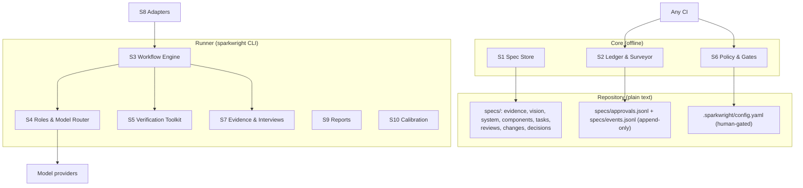

## Overview

SparkWright is three layers. The **Core** is plain files in the repository
(specs, evidence, approvals, events, config) plus a library that parses and
checks them with no network or model access. The **Runner** is the
`sparkwright` CLI: it drives agents through workflows, calls any model provider,
runs verification tools and enforces gates. **Adapters** let host coding agents
drive the same workflows with their own agents. Every feature works from the
CLI alone.



## Requirement line grammar

Every requirement is one Markdown bullet:

```
- **<ID>** [<ref>, <ref>, ...] <text>
  <optional continuation lines, indented two or more spaces>
```

Example with two refs and a continuation line:

```
- **S2.4** [V8, V1] When a requirement is approved, the system shall append an
  approval entry recording its hash.
```

- Refs are separated by commas; whitespace is ignored. `[]` is allowed on
  assumption and vision lines (a vision line with `[]` is reported by S1.4).
- A line that starts with `- **<something matching an ID pattern>**` but does not
  follow the grammar is a grammar error.
- Requirement hash: SHA-256 (hex) of the UTF-8 text with whitespace runs
  collapsed to one space, followed, for tasks with an extras block, by a newline
  and the extras as JSON with sorted keys. ID and refs are not hashed (refs are
  checked by S2.3). Test-file hash: SHA-256 of the file bytes with CRLF converted
  to LF. Evidence hash: requirement-text normalisation applied to the file body
  after the front matter.

## Components

| ID | Component | Responsibility | Parents |
| --- | --- | --- | --- |
| S1 | Spec Store | File formats, IDs, grammar, templates, deltas | V1, V2, V3, V10 |
| S2 | Ledger & Surveyor | Traceability, coverage, drift, approvals, status | V1, V2, V4, V8, V10 |
| S3 | Workflow Engine | review, interview, descend, build, change | V2, V3, V4 |
| S4 | Roles & Model Router | Personas, isolation, tiers, retries, ceilings | V2, V7, V9 |
| S5 | Verification Toolkit | Project checks, red check, mutation, property, library checks, proofs | V3 |
| S6 | Policy & Gates | Gates, approvals, risk tiers, protected paths, CI checks | V5, V8, V10, V11 |
| S7 | Evidence & Interviews | Owner interview, transcript ingest, synthesis, privacy | V6 |
| S8 | Adapters | Adapter contract, neutral skills, host packages | V7 |
| S9 | Reports | Status, trace, findings, PR descriptions, telemetry | V1, V8, V9 |
| S10 | Calibration | Planted-flaw suite and persona scoring | V9 |
| S11 | Non-functional | Offline core, determinism, JSON, secrets, plain text, performance | V1, V7, V10, V11 |

## Requirements

### S1 — Spec Store

- **S1.1** [V1] Every spec file shall begin with YAML front matter containing `id`, `title`, `type` and `status` (change requests use the change-request statuses); files of type component or task shall also contain `risk`; evidence files may contain `source`, `consent` and `simulated`.
- **S1.2** [V1] IDs shall match: evidence `E\d+`, assumption `A\d+`, vision `V\d+`, system `S\d+\.\d+`, component `C\d+\.\d+\.\d+`, task `C\d+\.\d+\.\d+\.T\d+`, review `R\d+`, change request `CR\d+`, decision `D\d+`. Leading zeros are not significant; two IDs equal after removing leading zeros are the same ID.
- **S1.3** [V2] The store shall support the levels Evidence, Vision, System, Component and Task, plus Constitution, Decision, Review and Change Request files, in the layout under "Repository layout".
- **S1.4** [V1] When a Vision requirement line cites no `E` or `A` ID, or cites only simulated evidence, the system shall report a `vision.no-evidence` gap.
- **S1.5** [V10] When a change is proposed to an approved spec, the change request file shall carry `ADDED`, `MODIFIED` and `REMOVED` sections, each containing complete requirement lines; MODIFIED lines keep their ID.
- **S1.6** [V2] The store shall ship templates for every file type, including an interview guide, installed by `init` under `.sparkwright/templates/`.
- **S1.7** [V10] When a Component file sets `lite: true`, its tasks shall be written as requirement lines in a `## Tasks` section of that file, using the normal task ID grammar.
- **S1.8** [V3] A task line may be followed by a fenced `yaml` block with `files` (list of globs the task may change; required for building), `invariants` (list of property statements, default empty) and `prove` (boolean, default false). Acceptance criteria are written in the task file under `## Acceptance criteria` as bullets beginning `AC<n>:`.

### S2 — Ledger & Surveyor

- **S2.1** [V1] The Surveyor shall build the ledger from spec files, `specs/approvals.jsonl`, `specs/events.jsonl`, git commit trailers and test annotations. A test annotation is the text `sparkwright: <ID>` anywhere in a file matching `test_globs`. Trailers are `SparkWright-Task: <ID>` (repeatable) and `SparkWright-Role: <role>`, keys case-sensitive; merge commits are skipped. The ledger is generated (`.sparkwright/ledger.json`, gitignored).
- **S2.2** [V1] `trace <ID>` shall report the chain up to evidence or assumptions and down to tasks, tests and commits.
- **S2.3** [V2] The Surveyor shall report as gaps: a parent with no child once the child level has any requirement; a child citing an unknown ID or an ID of the wrong level; a task citing a component other than its own; a task with derived status `done` and no test; a commit after the baseline with no task trailer, unless every file it changes is drift-exempt (S2.6), such as spec-only commits.
- **S2.4** [V8] When a requirement, evidence file, change request or test file is approved, the system shall append an entry to `specs/approvals.jsonl` with `id`, `hash`, `approver`, `role`, `change_request` and `time`. When an approved item's current hash differs from its latest approval, `check` shall fail. A changed requirement is re-approved only with an approved change request (`approve --cr CR<n>`).
- **S2.5** [V4] When a change request is approved, the Surveyor shall compute its affected set (the target and every descendant), and the engine shall append a `changed` event for each affected requirement whose derived status is `approved`, `building` or `done`; affected items in `draft` or `in-review` are listed in the change request but not changed.
- **S2.6** [V4] When a commit after the baseline changes a file that matches no `files` glob of any task with derived status `approved`, `building` or `done`, and the file is not exempt, `check` shall report drift. Exempt by default: `specs/**`, `.sparkwright/**`, `*.md`, `LICENSE`, `NOTICE`, `.gitignore`, `personas/**`, `templates/**`. Globs use shell matching where `*` matches across `/` and `dir/**` matches everything under `dir`. Drift is checked only once at least one task declares `files`.
- **S2.7** [V10] When `adopt` runs on an existing codebase, the Surveyor shall record the current commit as the baseline and draft Task, Component and System specs bottom-up, all in status `draft`.
- **S2.8** [V2] The derived status of a requirement shall be computed as: `changed` if its latest event is `changed` and no approval with a matching hash is newer; otherwise `done`, `building` or `blocked` if that is its latest build event; otherwise `approved` if its latest approval matches its current hash; otherwise the file's front matter status if `draft` or `in-review`; otherwise `draft`.
- **S2.9** [V10] When a change request with status `approved` declares `renames: {OLD: NEW}`, the ledger shall treat `OLD` in trailers, test annotations and approvals as `NEW`.

### S3 — Workflow Engine

- **S3.1** [V2] Workflows shall be state machines of named steps: `review`, `interview`, `descend`, `build` and `change`. One engine drives every workflow; `advance()` performs the next step or, in host mode, returns the step for a host agent to perform.
- **S3.2** [V2] Each run shall append JSON lines to `.sparkwright/runs/<run-id>.jsonl` with at least `run`, `workflow`, `step`, `status` (`started`, `done`, `failed`, `skipped`) and, for model calls, `role`, `tier`, `model`, `input_tokens`, `output_tokens`, `cost_usd`, `duration_s`. Run IDs match `YYYYMMDD-HHMMSS-<workflow>-<hex6>`. On resume, steps with status `done` are not repeated; a corrupt line is skipped.
- **S3.3** [V3] When `build` runs for an approved task, the engine shall execute: create workspace; Test Author; red check; Builder; verify; Library Checker; Saboteur; lock tests; Code Reviewer; commit. Failures follow the table under "Build failure handling".
- **S3.4** [V3] A Saboteur round fails when the mutation score on the task diff is below `mutation.min` (default 0.8). The engine shall then freeze the Builder's code and return to the Test Author with the surviving mutants; after 2 failed rounds the task becomes `blocked`.
- **S3.5** [V4] When the Builder returns a `spec_defect` report (`{"spec_defect": {"cited_id": "<ID>", "reason": "..."}}`), the engine shall stop the build, append a `changed` event for the task, and write a change request targeting `cited_id` if it is an ancestor of the task, otherwise the task's parent.
- **S3.6** [V4] A change request shall allow at most 2 rebuild rounds of an affected task (a round is one build attempt after the change request is applied); after that the change request becomes `blocked` until a human applies or rejects it.
- **S3.7** [V2] When an Inspector swarm finishes, the Foreman shall merge findings into one review file: findings from different personas merge when they share requirement IDs (identical sets with wording overlap of at least 0.15, or ID overlap of at least 0.5 with wording overlap of at least 0.19), ranked by severity then ID.
- **S3.8** [V3] Tasks whose `files` globs do not intersect shall build in parallel in separate workspaces; before merge, the engine shall compare the actual changed files and stop if two builds changed the same file.
- **S3.9** [V4] When an approved change request is applied and its target is re-reviewed and re-approved, the engine shall make its `changed` descendant tasks buildable again; their next build counts as a round under S3.6.
- **S3.10** [V4] When a change request is approved, the engine shall set its target to `in-review` and run the review workflow for the target's level before descendant tasks are rebuilt.

### S4 — Roles & Model Router

- **S4.1** [V2] Each role shall be defined in a persona file with front matter `name`, `version`, `tier`, `job`, `never_sees`, `output`, and a body that is the role's instructions. Built-in personas ship in the package; a file with the same name in `personas/` overrides it.
- **S4.2** [V2] When an Inspector, Test Author or Code Reviewer runs, it shall receive only the artifact under review, its parent specs, the constitution and, for build roles, the task's test and source files; never the authoring conversation or other Inspectors' reports.
- **S4.3** [V7] Model choice shall use provider-neutral tiers `top`, `mid`, `fast`; `models` maps each tier to a provider and model, `roles` maps a role to a tier (default: the persona's `tier`).
- **S4.4** [V9] When a role call fails (provider error or timeout), the router shall make one more attempt at the next tier up, or the same tier for `top`; when both fail, the role has failed and the engine applies "Build failure handling".
- **S4.5** [V9] Before each persona call, the router shall estimate its cost as the mean cost of earlier calls in the run; when the run or level ceiling would be exceeded, it shall skip remaining personas in priority order, except that the first 2 Inspectors always run. Cost comes from `price_per_mtok` per tier in config; tiers without prices count as zero.

### S5 — Verification Toolkit

- **S5.1** [V3] `sparkwright verify` shall run the commands in `checks` (`test`, `lint`, `types`, others) and fail if any exits non-zero; these results outrank any agent verdict. `check` never runs project commands.
- **S5.2** [V3] Red check: before the Builder runs, every new test file shall compile, and the test command run on the new tests shall exit non-zero. An import error of the code under test counts as red; a syntax error in a test file does not.
- **S5.3** [V3] The Saboteur shall mutate only lines changed or added since the workspace base (including new files), within `mutation.time_budget_s`. Score = killed / (killed + survived); a mutant that times out counts as killed; when the budget expires the score covers the mutants run and the report is marked partial.
- **S5.4** [V3] For each declared invariant, the Property Tester shall write a property-based test; v1 targets Python with Hypothesis when installed, and otherwise writes a parametrised test over generated examples.
- **S5.5** [V3] For Python tasks, the Library Checker shall extract `module.attr` uses of imported third-party modules from changed files with `ast`, import each module in a subprocess, and report attributes that do not exist; modules that cannot be imported are reported, not ignored.
- **S5.6** [V3] When a task sets `prove: true`, the Prover shall attempt machine-checked proofs; a failed proof shall block the merge gate.

### S6 — Policy & Gates

- **S6.1** [V5] An Inspector pass means at least 2 personas produced parseable output and no open high-severity finding remains. Gates: Evidence — human; Vision — Inspector pass and human; System — Inspector pass and human; Component and Task — Inspector pass (`gates.component` / `gates.task` may be `auto` or `human`); test lock — red check and Saboteur passed (recorded by the Runner); code — `verify` green, Code Reviewer pass, human merge.
- **S6.2** [V5] When an artifact has `risk: high`, the gate shall add the Security Reviewer and require a human, overriding `gates` config. Changing an artifact's `risk` shall require a human gate.
- **S6.3** [V8] Human approvals shall be recorded by `sparkwright approve <ID> --as <name>`. `check` shall accept a committed approval line with role `human` only when the commit that added it was authored by an email listed under `approvers` for that name, and, when `require_signed: true`, the commit signature verifies. Uncommitted approval lines are reported as `approval.pending`.
- **S6.4** [V5] Change requests targeting Vision, System or `risk: high` artifacts shall require human approval; others an Inspector pass.
- **S6.5** [V8] Protected paths shall be enforced in layers: the Runner shall refuse to write outside a role's allowed paths (Builder: the task's `files`; Test Author: `test_globs`); `check` shall fail when a commit with a `SparkWright-Role` trailer other than `human` changes a path protected for that role or a path in `always_protected`; host adapters install their own guard (S8).
- **S6.6** [V5] `always_protected` shall include `.sparkwright/config.yaml`, `specs/approvals.jsonl`, `specs/constitution.md`, `AGENTS.md`, `CLAUDE.md`, `.claude/**` and `personas/**`; config may add paths but not remove these.
- **S6.7** [V11] When reviewed text matches the instruction-pattern list (for example `ignore previous`, `you are now`, hidden HTML comments addressed to agents), the Security Reviewer shall join the review; matches outside code spans are high-severity findings, matches inside code spans are low.
- **S6.8** [V10] `sparkwright check` shall run grammar, coverage, approval, approver, drift and protected-path checks with no model access and exit non-zero on failure. Config may set only the `component` and `task` gates.
- **S6.9** [V8] `specs/approvals.jsonl` and `specs/events.jsonl` shall be append-only: their content at the baseline commit must be a prefix of their current content.

### S7 — Evidence & Interviews

- **S7.1** [V6] `sparkwright interview owner` shall record consent, then question the owner in the terminal one question at a time and write an evidence file.
- **S7.2** [V6] `sparkwright interview guide` shall draft an end-user interview guide based on past behaviour; an Inspector shall review it for leading questions.
- **S7.3** [V6] `sparkwright interview ingest <file> --consent "<how>"` shall turn a user-supplied transcript into an evidence file; without `--consent` it shall refuse.
- **S7.4** [V6] Before saving, the system shall replace email addresses and phone numbers (7–15 digits with a leading `+`, a parenthesised area code, or separators and at least 9 digits; dates excluded) and names given with `--redact`; the raw transcript is never written to `specs/`.
- **S7.5** [V6] Themes shall be synthesized by the Theme Synthesizer, not the Interviewer. A theme is new when its normalised name appears in no earlier non-simulated evidence file; when 3 consecutive interviews add no new theme, the system shall report saturation.
- **S7.6** [V6] Evidence with `simulated: true` shall never satisfy a Vision line's evidence citation.
- **S7.7** [V6] When a guide's target users include minors, the guide shall direct interviews to parents or require recorded parental consent.

### S8 — Adapters

- **S8.1** [V7] An adapter shall provide `spawn_agent`, `create_workspace`, `enforce_paths` and `model_for` as defined in `sparkwright.adapters.contract`, or declare a capability `None`.
- **S8.2** [V7] When a host lacks a capability, the Runner shall supply it. A same-context review shall never count as an Inspector review.
- **S8.3** [V7] Skills shall be authored once as neutral skill files (front matter `name`, `description`, `cli`, `personas`) and generated into each host's format by `sparkwright adapt <host>`.
- **S8.4** [V7] v1 shall ship the CLI and a Claude Code adapter (agents, skills, a guard hook on Write, Edit and Bash); other hosts use `sparkwright adapt agents-md`.

### S9 — Reports

- **S9.1** [V1] `status` shall show derived status per level, coverage gaps, open findings (review rows whose Decision is `open`), drift, approval problems and cost across all runs.
- **S9.2** [V8] When the engine commits a build, the commit message shall list every changed file; `check` shall fail when a commit with a `SparkWright-Role` trailer omits a changed file from its message.
- **S9.3** [V9] Each run shall log tokens, cost and duration per role.

### S10 — Calibration

- **S10.1** [V9] The project shall ship a suite of specs and code with planted flaws, each labelled with the persona expected to catch it.
- **S10.2** [V9] `calibrate` shall run each persona against the suite per tier and write catch rate and false-alarm rate to `specs/reviews/calibration.md`.
- **S10.3** [V9] When a persona's catch rate is below `calibration.min_catch_rate` (default 0.5), `calibrate` shall propose disabling it as a config change for human approval, never fewer than 2 Inspectors.

### S11 — Non-functional

- **S11.1** [V7] The Core shall run with no network and no model access.
- **S11.2** [V1] Given the same repository state, `check` and the ledger shall produce identical output: sorted keys, natural ID order, no timestamps.
- **S11.3** [V11] API keys shall be read from environment variables only and never written to files, logs or reports.
- **S11.4** [V10] `check` shall finish in under 10 seconds on a repository with 2,000 spec files and 1,000 commits after the baseline.
- **S11.5** [V11] The Core and Runner shall have at most one direct runtime dependency (PyYAML, D001); adding another requires a constitution change.
- **S11.6** [V11] Every command shall accept `--json` before or after the subcommand and emit `{"ok": bool, "command": str, "data": object}`, including for usage errors; exit codes are 0 success, 1 failure, 2 usage error.
- **S11.7** [V11] All persisted state shall be plain text in the repository or `.sparkwright/`; no database.

## Build failure handling

| Step | Fails when | Action |
| --- | --- | --- |
| Test Author | role fails, or writes outside `test_globs` | refused writes discarded; role failure → `blocked` |
| Red check | a test file does not compile, or the tests pass before code exists | back to Test Author (max 2 rounds) → `blocked` |
| Builder | role fails, or writes outside `files` | refused writes discarded; role failure → `blocked` |
| Builder | returns `spec_defect` | change request (S3.5) → task `changed` |
| Verify / Library Checker | any check fails | back to Builder with the output (max 2 rounds) → `blocked` |
| Saboteur | score below `mutation.min` | code frozen; back to Test Author (max 2 rounds, S3.4) → `blocked` |
| Code Reviewer | any high-severity finding | back to Builder (shares the Builder's 2 rounds) → `blocked` |
| Human merge | — | the engine stops after committing to branch `sparkwright/<task-id>`; the task becomes `done` when that commit is reachable from the main branch |

## MVP scope

| Phase | Requirements |
| --- | --- |
| MVP 1: offline core | S1.1–S1.4, S1.6, S1.8, S2.1–S2.4, S2.6, S2.8, S2.9, S6.3, S6.5, S6.6, S6.8, S6.9, S9.1, S11.1–S11.7 |
| MVP 2: agents | S3.1, S3.2, S3.7, S4.1–S4.5, S6.1, S6.7, S7.1, S7.3–S7.6, S8.1–S8.4, S9.3 |
| Phase 3: build loop | S1.5, S1.7, S2.5, S3.3–S3.6, S3.8–S3.10, S5.1–S5.5, S6.2, S6.4, S9.2 |
| Later | S2.7, S5.6, S7.2, S7.7, S10.1–S10.3 |

## Data model

| Entity | Key fields | Stored in |
| --- | --- | --- |
| Requirement | id, refs[], text, hash, file, line, extras | Requirement lines |
| Evidence | id, source, consent, simulated, statements, themes | `specs/evidence/E<n>-<slug>.md` |
| Approval | id, hash, approver, role, change_request, time | `specs/approvals.jsonl` |
| Event | id, event (`changed`, `building`, `blocked`, `done`, `cr-applied`), run, time, reason | `specs/events.jsonl` |
| Finding | F<n>, severity, requirements, finding, fix, raised_by, decision (`open`, `accepted`, `rejected`, `deferred`) | `specs/reviews/<date>-<target>-r<n>.md` |
| ChangeRequest | id, target, reason, status (`open`, `approved`, `rejected`, `applied`, `blocked`), rounds, affected[], renames | `specs/changes/CR<n>.md` |
| Decision | id, question, options, chosen, consequences | `specs/decisions/D<n>-<slug>.md` |
| Persona | name, version, tier, job, never_sees, output | package data, `personas/<name>.md` overrides |
| Run | run, workflow, step, status, per-role usage | `.sparkwright/runs/<run-id>.jsonl` |

**Derived statuses** (S2.8): `draft` → `in-review` → `approved` → `building` →
`done`; `building` → `blocked` or `changed`; `approved`/`done` → `changed`;
`changed` → `in-review` → `approved`; any → `rejected`.

## Repository layout

```
specs/
  constitution.md
  evidence/E01-owner-interview.md
  vision.md
  system.md
  components/C2-tutor-engine.md        # file id C2; holds requirements C2.1.1, C2.3.1, ...
  tasks/C2.3.1.T3-hint-ladder.md       # file id = task id
  reviews/  changes/  decisions/
  approvals.jsonl  events.jsonl        # committed, append-only
personas/                              # optional overrides, human-gated
.sparkwright/
  config.yaml                          # committed, human-gated
  templates/                           # from init
  ledger.json  runs/  worktrees/       # generated, gitignored
```

## Interfaces

| Command | Purpose | Phase |
| --- | --- | --- |
| `init` | Layout, templates, config, baseline | MVP 1 |
| `check` / `trace <ID>` / `status` | Offline checks and reports | MVP 1 |
| `approve <ID> --as <name> [--cr CR<n>] [--test]` | Record an approval | MVP 1 |
| `review <ID> [--prepare / --collect RUN]` | Inspector swarm | MVP 2 |
| `interview owner \| ingest <file>` | Evidence | MVP 2 |
| `adapt claude-code \| agents-md` | Host adapters | MVP 2 |
| `mutate --base <rev>` | Saboteur on a diff | Phase 3 |
| `verify` | Run project checks | Phase 3 |
| `build <task-id> [--next]` | Build workflow; `--next` is host mode | Phase 3 |
| `change <ID> --reason "..."` / `change apply CR<n>` | Change requests | Phase 3 |
| `descend <ID>` | Draft the next level | Phase 3 |
| `adopt` / `calibrate` | Brownfield / persona scoring | Later |

Provider interface: `complete(messages, model, max_tokens) -> (text, Usage)`
where `Usage` has `input_tokens` and `output_tokens`.

Configuration adds to v0.2: `approvers: [{name, email}]`, `require_signed`,
`price_per_mtok` per tier, `always_protected` (additive), `calibration.min_catch_rate`.

## Coverage map

| Vision | Covered by |
| --- | --- |
| V1 | S1.1, S1.2, S1.4, S2.1, S2.2, S9.1, S11.2 |
| V2 | S1.3, S1.6, S2.3, S2.8, S3.1, S3.2, S3.7, S4.1, S4.2 |
| V3 | S1.8, S3.3, S3.4, S3.8, S5.1–S5.6 |
| V4 | S2.5, S2.6, S3.5, S3.6, S3.9, S3.10 |
| V5 | S6.1, S6.2, S6.4, S6.6 |
| V6 | S7.1–S7.7 |
| V7 | S4.3, S8.1–S8.4, S11.1 |
| V8 | S2.4, S6.3, S6.5, S6.9, S9.2 |
| V9 | S4.4, S4.5, S9.3, S10.1–S10.3 |
| V10 | S1.5, S1.7, S2.7, S2.9, S6.8, S11.4 |
| V11 | S6.7, S11.3, S11.5, S11.6, S11.7 |

## Open questions

- Mutation tool for JS/TS (Stryker) in Phase 4.
