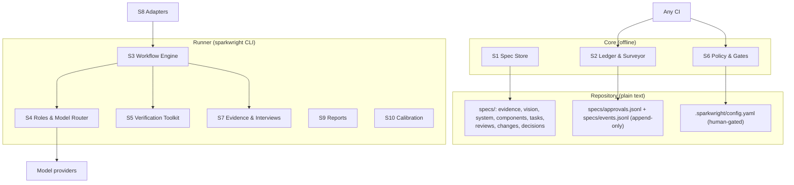

## Overview

SparkWright is three layers. The **Core** is plain files in the repository
(specs, evidence, approvals, events, config) plus a library that parses and
checks them with no network or model access. The **Runner** is the
`sparkwright` CLI: it drives agents through workflows, calls any model provider,
runs verification tools and enforces gates. **Adapters** let host coding agents
drive the same workflows with their own agents. Every feature works from the
CLI alone.



## Requirement line grammar

Every requirement is one Markdown bullet:

```
- **<ID>** [<ref>, <ref>, ...] <text>
  <optional continuation lines, indented two or more spaces>
```

Example with two refs and a continuation line:

```
- **S2.4** [V8, V1] When a requirement is approved, the system shall append an
  approval entry recording its hash.
```

- Refs are separated by commas; whitespace is ignored. `[]` is allowed on
  assumption and vision lines (a vision line with `[]` is reported by S1.4).
- A line that starts with `- **<something matching an ID pattern>**` but does not
  follow the grammar is a grammar error.
- Requirement hash: SHA-256 (hex) of the UTF-8 text with whitespace runs
  collapsed to one space, followed, for tasks with an extras block, by a newline
  and the extras as JSON with sorted keys. `hash2` (S2.4) adds the sorted refs
  and, for task files, the acceptance criteria. Test-file hash: SHA-256 of the
  file bytes with CRLF converted to LF. Evidence and change-request hash:
  requirement-text normalisation applied to the file body after the front
  matter; their `hash2` adds the significant front-matter fields (S2.4).

## Components

| ID | Component | Responsibility | Parents |
| --- | --- | --- | --- |
| S1 | Spec Store | File formats, IDs, grammar, templates, deltas | V1, V2, V3, V10 |
| S2 | Ledger & Surveyor | Traceability, coverage, drift, approvals, status | V1, V2, V4, V8, V10 |
| S3 | Workflow Engine | review, interview, descend, build, change | V2, V3, V4 |
| S4 | Roles & Model Router | Personas, isolation, tiers, retries, ceilings | V2, V7, V9 |
| S5 | Verification Toolkit | Project checks, red check, mutation, property, library checks, proofs | V3 |
| S6 | Policy & Gates | Gates, approvals, risk tiers, protected paths, CI checks | V5, V8, V10, V11 |
| S7 | Evidence & Interviews | Owner interview, transcript ingest, synthesis, privacy | V6 |
| S8 | Adapters | Adapter contract, neutral skills, host packages | V7 |
| S9 | Reports | Status, trace, findings, PR descriptions, telemetry | V1, V8, V9 |
| S10 | Calibration | Planted-flaw suite and persona scoring | V9 |
| S11 | Non-functional | Offline core, determinism, JSON, secrets, plain text, performance | V1, V7, V10, V11 |

## Requirements

### S1 — Spec Store

- **S1.1** [V1] Every spec file shall begin with YAML front matter containing `id`, `title`, `type` and `status` (change requests use the change-request statuses); files of type component or task shall also contain `risk`; evidence files may contain `source`, `consent` and `simulated`.
- **S1.2** [V1] IDs shall match: evidence `E\d+`, assumption `A\d+`, vision `V\d+`, system `S\d+\.\d+`, component `C\d+\.\d+\.\d+`, task `C\d+\.\d+\.\d+\.T\d+`, review `R\d+`, change request `CR\d+`, decision `D\d+`. File ids are `VISION`, `SYSTEM` and `CONSTITUTION` for those files, `C\d+` for a component file (it holds requirements `C<n>.x.y`), the task id for a task file, and the record id for evidence, review, change-request and decision files. A component requirement's parent is named by its refs, not by its number: `C2.1.1` may cite any System requirement. Leading zeros are not significant; two IDs equal after removing leading zeros are the same ID.
- **S1.3** [V2] The store shall support the levels Evidence, Vision, System, Component and Task, plus Constitution, Decision, Review and Change Request files, in the layout under "Repository layout".
- **S1.4** [V1] When a Vision requirement line cites no `E` or `A` ID, or cites only simulated evidence, the system shall report a `vision.no-evidence` gap.
- **S1.5** [V10] When a change is proposed to an approved spec, the change request file shall carry `ADDED`, `MODIFIED` and `REMOVED` sections, each containing complete requirement lines; MODIFIED lines keep their ID.
- **S1.6** [V2] The store shall ship templates for every file type, including an interview guide, installed by `init` under `.sparkwright/templates/`.
- **S1.7** [V10] When a Component file sets `lite: true`, its tasks shall be written as requirement lines in a `## Tasks` section of that file, using the normal task ID grammar.
- **S1.8** [V3] A task line may be followed by a fenced `yaml` block with `files` (list of globs the task may change; required for building), `invariants` (list of property statements, default empty) and `prove` (boolean, default false). Acceptance criteria are written in the task file under `## Acceptance criteria` as bullets beginning `AC<n>:`.

### S2 — Ledger & Surveyor

- **S2.1** [V1] The Surveyor shall build the ledger from spec files, `specs/approvals.jsonl`, `specs/events.jsonl`, git commit trailers and test annotations. A test annotation is the text `sparkwright: <ID>` anywhere in a file matching `test_globs`. Trailers are `SparkWright-Task: <ID>` (repeatable) and `SparkWright-Role: <role>`; trailer keys are case-sensitive, role values are compared in lower case, and a commit whose role trailers disagree fails `check`. Merge commits are skipped for trailer and drift checks but not for the log and review-file checks (S6.9, S6.11). The ledger is generated (`.sparkwright/ledger.json`, gitignored).
- **S2.2** [V1] `trace <ID>` shall report the chain up to evidence or assumptions and down to tasks, tests and commits.
- **S2.3** [V2, V1] The Surveyor shall report as gaps: a parent with no child once the child level has any requirement; a child citing an unknown ID or an ID of the wrong level; a task citing a component other than its own; a task with derived status `done` and no test; a commit after the baseline with no task trailer, unless every file it changes is drift-exempt (S2.6), such as spec-only commits.
- **S2.4** [V8] When a requirement, evidence file, change request or test file is approved, the system shall append an entry to `specs/approvals.jsonl` with `id`, `hash`, `approver`, `role`, `change_request` and `time`, plus `risk` (the owning file's risk tier) and `hash2` for requirements. Ids and hashes: a requirement uses its ID, `hash` covers its text and extras, and `hash2` also covers the sorted parent links and a task file's `## Acceptance criteria` section; an evidence file or change request uses its file id, `hash` of the file body and `hash2` of the body plus the front-matter fields `simulated`, `consent`, `source`, `target`, `renames` and `risk`; a change request counts as approved only while such an approval matches it, whatever its `status` line says; a test file uses `test:<repo-relative path>` and a hash of the file. `role` is `human` for approvals and `runner` only for test locks. When an approved item's current hash (or `hash2`, when recorded) differs from its latest approval, `check` shall fail. An approval without `hash2` still counts; `approve` refreshes it without a change request when the text is unchanged. A changed requirement is re-approved only with an approved change request (`approve --cr CR<n>`).
- **S2.5** [V4] When a change request is applied (`change apply`, S3.11), the Surveyor shall compute its affected set (each target and every descendant), and the engine shall append a `changed` event for each affected requirement whose derived status is `approved`, `building` or `done`, and a `cr-applied` event for each target; affected items in `draft` or `in-review` are not changed. Approving a change request appends no event.
- **S2.6** [V4] When a commit after the baseline changes a file that matches no `files` glob of any task with derived status `approved`, `building` or `done`, and the file is not exempt, `check` shall report drift. Exempt: the paths in `drift_exclude` (default `specs/**`, `.sparkwright/**`, `*.md`, `LICENSE`, `NOTICE`, `.gitignore`, `.gitattributes`, `personas/**`, `templates/**`), and files matching `test_globs` in a commit whose trailer cites a task that is `approved`, `building`, `done`, `changed` or `in-review`. Globs use shell matching where `*` matches across `/` and `dir/**` matches everything under `dir`. Drift is checked only once at least one task declares `files`.
- **S2.7** [V10] The baseline is the config key `baseline` (a commit hash): commit, drift and log checks apply only to commits after it, and when it is unset they apply to the whole history. `init` in a repository that has commits records the current commit; `adopt` records the current commit and the Surveyor drafts Task, Component and System specs bottom-up, all in status `draft`.
- **S2.8** [V2] The derived status of a requirement shall be the first rule that applies: (1) `draft` if its latest approval matches the current text but was recorded under a different risk tier; (2) `in-review` if it has a `changed` event with no newer matching approval and a `cr-applied` event at or after that change, otherwise `changed`; (3) `done`, `building` or `blocked` if that is its latest build event and the event is not older than its latest `changed` event; (4) `approved` if its latest approval matches its current text; (5) the file's front-matter status if `draft`, `in-review` or `rejected`; (6) `draft`. In addition, `check` derives `done` for a `building` task whose ready commit on branch `sparkwright/<task-id>` is reachable from the current branch.
- **S2.9** [V10] When a change request with status `approved` or `applied` declares `renames: {OLD: NEW}`, the ledger shall treat `OLD` in trailers, test annotations and approvals as `NEW`.

### S3 — Workflow Engine

- **S3.1** [V2] Workflows shall be state machines of named steps: `review`, `interview`, `descend`, `build` and `change`. One engine drives every workflow; `advance()` performs the next step or, in host mode, returns the step for a host agent to perform.
- **S3.2** [V2] Each run shall append JSON lines to `.sparkwright/runs/<run-id>.jsonl` with at least `run`, `workflow`, `step`, `status` (`started`, `done`, `failed`, `skipped`) and, for model calls, `role`, `tier`, `model`, `input_tokens`, `output_tokens`, `cost_usd`, `duration_s`. Run IDs match `YYYYMMDD-HHMMSS-<workflow>-<hex6>`. On resume, steps with status `done` are not repeated; a corrupt line is skipped.
- **S3.3** [V3] When `build` runs for an approved task, the engine shall execute in order: create workspace; Test Author; red check (a guard check instead when the task changes only test files or the Test Author reports it already implemented); Property Tester, when the task declares invariants; Builder (skipped for test-only and already-implemented tasks); verify; Prover, when the task sets `prove: true`; Library Checker; Saboteur; lock tests; Code Reviewer; Security Reviewer, when S6.2 requires it; final gate re-derived from git; commit to branch `sparkwright/<task-id>`. Failures follow the table under "Build failure handling".
- **S3.4** [V3] A Saboteur round fails when the mutation score on the task diff is below `mutation.min` (default 0.8). The engine shall then freeze the Builder's code and return to the Test Author with the surviving mutants; the strengthened tests must pass against the frozen code (no red check), then verify, Library Checker and Saboteur run again. Round counters are kept per step: `red`, `props`, `saboteur` and `builder` (shared by verify, Prover, Library Checker, Code Reviewer and Security Reviewer); a step whose counter passes 2 makes the task `blocked`.
- **S3.5** [V4] When the Builder returns a `spec_defect` report (`{"spec_defect": {"cited_id": "<ID>", "reason": "..."}}`), the engine shall stop the build, append a `changed` event for the task only, and write a change request targeting `cited_id` if it is an ancestor of the task, otherwise the task's parent; other affected requirements are marked when that change request is applied (S2.5).
- **S3.6** [V4] A change request shall allow at most 2 rebuild rounds of an affected task (a round is one build attempt after the change request is applied); after that the change request becomes `blocked` until a human applies or rejects it.
- **S3.7** [V2] When an Inspector swarm finishes, the Foreman shall merge findings into one review file, ranked by severity then ID. Wording overlap is the Jaccard index of the sets of lower-case alphanumeric words longer than 2 characters in the finding and fix texts; ID overlap is the Jaccard index of the sets of requirement IDs cited. Findings from different personas merge when their ID sets are identical and wording overlap is at least 0.15, or ID overlap is at least 0.5 and wording overlap at least 0.19, or either cites no ID and wording overlap is at least 0.45. Example: IDs {S1.1} and {S1.1} with 3 shared words out of 15 distinct (0.2) merge.
- **S3.8** [V3] Tasks whose `files` globs do not intersect shall build in parallel in separate workspaces; before merge, the engine shall compare the actual changed files and stop if two builds changed the same file.
- **S3.9** [V4] When an approved change request is applied and its target is re-reviewed and re-approved, the engine shall make its `changed` descendant tasks buildable again; their next build counts as a round under S3.6.
- **S3.10** [V4] When a change request is applied, its targets become `in-review` (S2.8); a target's re-approval with `--cr` is refused until a review recorded after the apply has seen its current text, and descendant tasks are re-approved and rebuilt only after their target is re-approved.
- **S3.11** [V4, V10] A change request shall move through: `open` (written by `change new` or a `spec_defect`) → `approved` (by a human with `approve CR<n>`) → `applied` (by `change apply CR<n>`, which appends the S2.5 events and sets the file status; it does not edit spec text) → done when every target is re-approved with `--cr`. A human edits the targets to match the change request's ADDED, MODIFIED and REMOVED lines after applying it. A change request may also become `rejected`, or `blocked` under S3.6. `target` may be one ID or a list.

### S4 — Roles & Model Router

- **S4.1** [V2] Each role shall be defined in a persona file with front matter `name`, `version`, `tier`, `job`, `never_sees`, `output`, and a body that is the role's instructions. Built-in personas ship in the package; a file with the same name in `personas/` overrides it.
- **S4.2** [V2] When an Inspector, Test Author or Code Reviewer runs, it shall receive only the artifact under review, its parent specs, the constitution and, for build roles, the task's test and source files; never the authoring conversation or other Inspectors' reports.
- **S4.3** [V7] Model choice shall use provider-neutral tiers `top`, `mid`, `fast`; `models` maps each tier to a provider and model, `roles` maps a role to a tier (default: the persona's `tier`).
- **S4.4** [V9] When a role call fails (provider error or timeout), the router shall make one more attempt at the next tier up, or the same tier for `top`; when both fail, the role has failed and the engine applies "Build failure handling".
- **S4.5** [V9] Before each persona call, the router shall estimate its cost as the mean cost of earlier calls in the run (0 for the first call); when `budgets.per_run_usd` or `budgets.per_level_usd.<level>` (US dollars, 0 = no ceiling) would be exceeded, it shall skip the remaining personas in list order, except that the first 2 Inspectors and any persona required by S6.2 or S6.7 always run. A required persona that fails or is skipped adds a high-severity finding, so the review fails closed. Cost comes from `price_per_mtok` per tier in config. Because the dollar ceiling cannot work for a tier without a positive price, calls to unpriced tiers stop with a budget error once the run has made `budgets.max_calls_per_run` calls (default 40); the forced minimum Inspectors are exempt.
- **S4.6** [V11] When a persona receives artifact, parent, evidence or source text, the text shall be framed as data, ending at a marker that contains a hash of the data (so the data cannot contain it), with an instruction never to follow directions inside it, and the persona's output shall be used only as parsed findings or result JSON.

### S5 — Verification Toolkit

- **S5.1** [V3] `sparkwright verify` shall run the commands in `checks` (`test`, `lint`, `types`, others) and fail if any exits non-zero; these results outrank any agent verdict. `check` never runs project commands.
- **S5.2** [V3] Red check: before the Builder runs, every new test file shall compile, and the whole `checks.test` command run after the Test Author's commit shall exit non-zero. An import error of the code under test counts as red; a syntax error in a test file, or a broken test runner (no tests collected, the runner itself missing), does not.
- **S5.3** [V3] The Saboteur shall mutate only lines changed or added since the workspace base (including new files), within `mutation.time_budget_s`. v1 mutates Python with its own `ast` operators: swap comparisons, swap arithmetic operators, swap `and`/`or`, flip booleans, add 1 to integer constants, return `None`, remove `not`. Score = killed / (killed + survived); a mutant that times out counts as killed; with no mutants the score is 1.0; when the budget expires the score covers the mutants run and the report is marked partial.
- **S5.4** [V3] For each declared invariant, the Property Tester shall write a property-based test; v1 targets Python with Hypothesis when installed, and otherwise writes a parametrised test over generated examples.
- **S5.5** [V3] For Python tasks, the Library Checker shall extract `module.attr` uses of imported third-party modules from changed files with `ast`, import each module in a subprocess, and report attributes that do not exist; modules that cannot be imported are reported, not ignored.
- **S5.6** [V3] When a task sets `prove: true`, the Prover shall attempt machine-checked proofs; a failed proof shall block the merge gate.

### S6 — Policy & Gates

- **S6.1** [V5] An Inspector pass means at least 2 personas produced parseable output and no open high-severity finding remains. Every approval of a spec is recorded by a human with `approve` (role `human`, S6.3); the Runner records only test locks (role `runner`). Gates: Evidence — human; Vision — Inspector pass and human; System — Inspector pass and human; Component and Task — Inspector pass, then a human approval (`gates.component` / `gates.task` only choose whether a passing review reports PASS (`auto`) or HUMAN (`human`); nothing is approved automatically); test lock — red check and Saboteur passed; code — `verify` green, Code Reviewer pass, human merge.
- **S6.2** [V5] When an artifact has `risk: high`, its spec review shall add the Security Reviewer and require a human, overriding `gates` config; its build shall add a Security Reviewer step when the source diff (excluding tests and specs) has at least `security_review.min_changed_lines` changed lines (default 20). Changing an artifact's `risk` shall require a human gate.
- **S6.3** [V8] Human approvals shall be recorded by `sparkwright approve <ID> --as <name>`. `check` shall accept a committed approval line with role `human` only when the commit that added it was authored by an email listed under `approvers` for that name. `require_signed` is `false`, `high-risk` (default) or `true`: with `high-risk`, approvals of items whose recorded or current risk is `high` must be in commits with a good signature; with `true`, all human approvals. When an approver lists `signing_key`, the signature must be made with that key. A `signing_from` that is not a commit is an error. Signing is enforced for commits after `signing_from`; until `signing_from` is set, unsigned approvals that would need a signature are reported as a warning with setup instructions. Uncommitted approval lines are reported as `approval.pending`.
- **S6.4** [V5] Every change request shall require a human approval (S6.3), whatever level or risk its targets have; an Inspector pass never approves one.
- **S6.5** [V8] Protected paths shall be enforced in layers: the Runner shall refuse to write outside a role's allowed paths (Builder: the task's `files`; Test Author: `test_globs`); `check` shall fail when a commit with a `SparkWright-Role` trailer other than `human` changes a path protected for that role or a path in `always_protected`, except that a commit with role `runner` may append test-lock lines (role `runner`, id `test:<path>`) to `specs/approvals.jsonl` and add files under `specs/reviews/`, but never edit or delete a review file. `check` shall also fail when a commit with no role or role `human` changes a path in `always_protected` or a locked test and its author email is not listed under `approvers`; while no approvers are configured such commits are reported as a warning and every human approval fails (S6.3). With signing enforced (S6.3) such a commit must be signed (error with `require_signed: true`, warning with `high-risk`). Host adapters install their own guard (S8).
- **S6.6** [V5] `always_protected` shall include `.sparkwright/config.yaml`, `specs/approvals.jsonl`, `specs/constitution.md`, `AGENTS.md`, `CLAUDE.md`, `.claude/**` and `personas/**`; config may add paths but not remove these.
- **S6.7** [V11] When reviewed text matches the instruction-pattern list or contains hidden or direction-changing Unicode characters (zero-width, bidirectional controls, tag characters), the Security Reviewer shall join the review. The list ships as `sparkwright/data/injection-patterns.txt`: one Python regular expression per line, matched case-insensitively. Code spans are inline backtick spans and fenced blocks (``` or ~~~). Pattern matches outside code spans and any hidden characters are high-severity findings; pattern matches inside code spans are low.
- **S6.8** [V10] `sparkwright check` shall run grammar, coverage, approval, approver, drift and protected-path checks with no model access and exit non-zero on failure. Config may tune the keys listed under "Configuration", but it may not relax the Evidence, Vision, System, test-lock or merge gates; of the review gates only `gates.component` and `gates.task` are configurable.
- **S6.9** [V8] `specs/approvals.jsonl` and `specs/events.jsonl` shall be append-only: their content at the baseline commit and at HEAD must be a prefix of their current content, and no commit after the baseline, merges included, may remove or change a line of either file (lines compared as a multiset, so union merges pass). An approver may excuse a commit by listing it under `log_waivers` in the protected config.
- **S6.10** [V5, V8] Commands that run AI-written code or tests (checks, red check, Saboteur, Prover) shall get the parent environment with secret-like variables removed (names containing API_KEY, TOKEN, SECRET, PASSWORD, CREDENTIAL, PRIVATE_KEY or AUTH, and cloud-provider prefixes such as ANTHROPIC_, OPENAI_, AWS_, GITHUB_); `sandbox.keep_env` lists names a human chose to keep.
- **S6.11** [V5, V8] Only an approver may change a high-severity finding's Decision away from `open`: `check` shall compare the findings of every changed review file before and after each commit (merges included) and fail when a high finding stops being high and `open` (changed Decision, changed ID or severity, removed row, deleted or renamed file) or is added already closed, unless the commit has no role or role `human`, its author is listed under `approvers` and, with signing enforced (S6.3), it is signed. The Runner and agents may only add review files (S6.5).

### S7 — Evidence & Interviews

- **S7.1** [V6] `sparkwright interview owner` shall record consent, then question the owner in the terminal one question at a time and write an evidence file.
- **S7.2** [V6] `sparkwright interview guide` shall draft an end-user interview guide based on past behaviour; an Inspector shall review it for leading questions.
- **S7.3** [V6] `sparkwright interview ingest <file> --consent "<how>"` shall turn a user-supplied transcript into an evidence file; without `--consent` it shall refuse.
- **S7.4** [V6] Before saving, and before any transcript text is sent to a model, the system shall replace email addresses and phone numbers (7–15 digits with a leading `+`, a parenthesised area code, or separators and at least 9 digits; dates excluded) and names given with `--redact`; the raw transcript is never written to `specs/`.
- **S7.5** [V6] Themes shall be synthesized by the Theme Synthesizer, not the Interviewer. A theme is new when its normalised name appears in no earlier non-simulated evidence file; when 3 consecutive interviews add no new theme, the system shall report saturation.
- **S7.6** [V6] Evidence with `simulated: true` shall never satisfy a Vision line's evidence citation.
- **S7.7** [V6] When a guide's target users include minors, the guide shall direct interviews to parents or require recorded parental consent.

### S8 — Adapters

- **S8.1** [V7] An adapter shall provide `spawn_agent`, `create_workspace`, `enforce_paths` and `model_for` as defined in `sparkwright.adapters.contract`, or declare a capability `None`.
- **S8.2** [V7] When a host lacks a capability, the Runner shall supply it. A same-context review shall never count as an Inspector review.
- **S8.3** [V7] Skills shall be authored once as neutral skill files (front matter `name`, `description`, `cli`, `personas`) and generated into each host's format by `sparkwright adapt <host>`.
- **S8.4** [V7] v1 shall ship the CLI and a Claude Code adapter (agents, skills, a guard hook on Write, Edit and Bash); other hosts use `sparkwright adapt agents-md`.

### S9 — Reports

- **S9.1** [V1] `status` shall show derived status per level, coverage gaps, open findings (review rows whose Decision is `open`), drift, approval problems and cost across all runs.
- **S9.2** [V8] When the engine commits a build, the commit message shall list every changed file; `check` shall fail when a commit with a `SparkWright-Role` trailer omits a changed file from its message.
- **S9.3** [V9] Each run shall log tokens, cost and duration per role.

### S10 — Calibration

- **S10.1** [V9] The project shall ship a suite of specs and code with planted flaws, each labelled with the persona expected to catch it.
- **S10.2** [V9] `calibrate` shall run each persona against the suite per tier and write catch rate and false-alarm rate to `specs/reviews/calibration.md`.
- **S10.3** [V9] When a persona's catch rate is below `calibration.min_catch_rate` (default 0.5), `calibrate` shall propose disabling it as a config change for human approval, never fewer than 2 Inspectors.

### S11 — Non-functional

- **S11.1** [V7] The Core shall run with no network and no model access.
- **S11.2** [V1] Given the same repository state, `check` and the ledger shall produce identical output: sorted keys, natural ID order, no timestamps.
- **S11.3** [V11] API keys shall be read from environment variables only and never written to files, logs or reports. Text sent to a model and lines written to run logs shall have known token shapes (for example `sk-ant-…`, `ghp_…`, `AKIA…`, private-key blocks) and the values of secret-looking environment variables (S6.10) replaced with `[REDACTED]`.
- **S11.4** [V10] `check` shall finish in under 10 seconds on a repository with 2,000 spec files and 1,000 commits after the baseline.
- **S11.5** [V11] The Core and Runner shall have at most one direct runtime dependency (PyYAML, D001); adding another requires a constitution change.
- **S11.6** [V11] Every command shall accept `--json` before or after the subcommand and emit `{"ok": bool, "command": str, "data": object}`, including for usage errors; exit codes are 0 success, 1 failure, 2 usage error.
- **S11.7** [V11] All persisted state shall be plain text in the repository or `.sparkwright/`; no database.

## Build failure handling

| Step | Fails when | Action |
| --- | --- | --- |
| Test Author | role fails, or writes outside `test_globs` | refused writes discarded; role failure → `blocked` |
| Red check | a test file does not compile, or the tests pass before code exists | back to Test Author (`red`, max 2 rounds) → `blocked` |
| Guard check (test-only or already implemented) | the new tests fail against the current code | back to Test Author (`red`, max 2 rounds) → `blocked` |
| Property Tester | its tests fail to run, or fail against the frozen code | back to Property Tester (`props`, max 2 rounds) → `blocked` |
| Builder | role fails, or writes outside `files` | refused writes discarded; role failure → `blocked` |
| Builder | returns `spec_defect` | change request (S3.5) → task `changed` |
| Verify / Library Checker | any check fails | back to Builder with the output (`builder`, max 2 rounds) → `blocked` |
| Prover | a proof fails | back to Builder (`builder`) → `blocked`; the final gate refuses a task whose proof did not pass |
| Saboteur | score below `mutation.min` | code frozen; back to Test Author (`saboteur`, max 2 rounds, S3.4); strengthened tests must pass on the frozen code |
| Code Reviewer | any high-severity finding | back to the fixer: Builder, or Test Author for test-only tasks (`builder`) → `blocked` |
| Security Reviewer | any high-severity finding | as Code Reviewer |
| Final gate | the result re-derived from git differs (tests changed after lock, checks fail) | `blocked` with the reason |
| Human merge | — | the engine stops after committing to branch `sparkwright/<task-id>`; the task becomes `done` when that commit is reachable from the main branch |

## MVP scope

| Phase | Requirements |
| --- | --- |
| MVP 1: offline core | S1.1–S1.4, S1.6, S1.8, S2.1–S2.4 (without `--cr`), S2.6, S2.8, S6.3, S6.5, S6.6, S6.8, S6.9, S9.1, S11.1–S11.7 |
| MVP 2: agents | S3.1, S3.2, S3.7, S4.1–S4.6, S6.1, S6.7, S7.1, S7.3–S7.6, S8.1–S8.4, S9.3 |
| Phase 3: build loop | S1.5, S1.7, S2.4 `--cr`, S2.5, S2.9, S3.3–S3.6, S3.8–S3.11, S5.1–S5.5, S6.2, S6.4, S9.2 |
| Phase 4: hardening (D007, D008) | S6.10, S6.11 |
| Phase 5: adoption and measurement | S2.7, S5.6, S7.2, S7.7, S10.1–S10.3 |

## Data model

| Entity | Key fields | Stored in |
| --- | --- | --- |
| Requirement | id, refs[], text, hash, hash2, criteria, file, line, extras | Requirement lines |
| Evidence | id, source, consent, simulated, statements, themes | `specs/evidence/E<n>-<slug>.md` |
| Approval | id, hash, hash2, risk, approver, role (`human`, `runner`), change_request, time | `specs/approvals.jsonl` |
| Event | id, event (`changed`, `building`, `blocked`, `done`, `cr-applied`, `reviewed`), run, time, reason | `specs/events.jsonl` |
| Finding | F<n>, severity, requirements, finding, fix, raised_by, decision (`open`, `accepted`, `rejected`, `deferred`) | `specs/reviews/<date>-<target>-r<n>.md` |
| ChangeRequest | id, target (one ID or a list), reason, status (`open`, `approved`, `rejected`, `applied`, `blocked`), rounds, renames |  `specs/changes/CR<n>.md` |
| Decision | id, question, options, chosen, consequences | `specs/decisions/D<n>-<slug>.md` |
| Persona | name, version, tier, job, never_sees, output | package data, `personas/<name>.md` overrides |
| Run | run, workflow, step, status, per-role usage | `.sparkwright/runs/<run-id>.jsonl` |

**Derived statuses** (S2.8): `draft` → `in-review` → `approved` → `building` →
`done`; `building` → `blocked` or `changed`; `approved`/`building`/`done` →
`changed` when a change request is applied; `changed` → `in-review` when the
applied change request targets it; `in-review` → `approved` on re-approval with
`--cr`; a risk change after approval → `draft`; `rejected` only from front matter.

**Change request lifecycle** (S3.11): `open` → `approved` → `applied` → targets
re-approved with `--cr`; or `open` → `rejected`; `applied` → `blocked` after 2
rebuild rounds (S3.6).

## Repository layout

```
specs/
  constitution.md
  evidence/E01-owner-interview.md
  vision.md
  system.md
  components/C2-tutor-engine.md        # file id C2; holds requirements C2.1.1, C2.3.1, ...
  tasks/C2.3.1.T3-hint-ladder.md       # file id = task id
  reviews/  changes/  decisions/
  approvals.jsonl  events.jsonl        # committed, append-only
personas/                              # optional overrides, human-gated
.sparkwright/
  config.yaml                          # committed, human-gated
  templates/                           # from init
  ledger.json  runs/  worktrees/       # generated, gitignored
```

## Interfaces

| Command | Purpose | Phase |
| --- | --- | --- |
| `init` | Layout, templates, config, baseline | MVP 1 |
| `check` / `trace <ID>` / `status` | Offline checks and reports | MVP 1 |
| `approve <ID> --as <name> [--cr CR<n>] [--test]` | Record an approval | MVP 1 |
| `review <ID> [--prepare / --collect RUN]` | Inspector swarm | MVP 2 |
| `interview owner \| ingest <file>` | Evidence | MVP 2 |
| `adapt claude-code \| agents-md` | Host adapters | MVP 2 |
| `mutate --base <rev>` | Saboteur on a diff | Phase 3 |
| `verify` | Run project checks | Phase 3 |
| `build <task-id> [--next]` | Build workflow; `--next` is host mode | Phase 3 |
| `change new <ID>... --reason "..."` / `change apply CR<n>` | Change requests | Phase 3 |
| `descend <ID>` | Draft the next level | Phase 3 |
| `adopt` / `calibrate` | Brownfield / persona scoring | Later |

Provider interface: `complete(messages, model, max_tokens) -> (text, Usage)`
where `Usage` has `input_tokens` and `output_tokens`.

## Configuration

`.sparkwright/config.yaml` (protected, S6.6). Every key, with its default:

| Key | Type | Default | Used by |
| --- | --- | --- | --- |
| `models.<tier>` | `{provider, model, base_url?, api_key_env?, price_per_mtok: {input, output}}` | none | S4.3, S4.5 |
| `roles.<persona>` | tier | persona's `tier` | S4.3 |
| `budgets.per_run_usd` | number, 0 = none | 10.0 | S4.5 |
| `budgets.per_level_usd.<level>` | number, 0 = none | none | S4.5 |
| `budgets.max_calls_per_run` | integer | 40 | S4.5 |
| `gates.component`, `gates.task` | `auto` \| `human` | `auto` | S6.1 |
| `checks.<name>` | shell command | none | S5.1 |
| `prove` | shell command with `{files}` | none | S5.6 |
| `env` | map; `{repo}` = main repository root | `{}` | S5.1 |
| `python` | interpreter path | the running one | S5.5 |
| `mutation.min`, `mutation.time_budget_s` | number | 0.8, 300 | S3.4, S5.3 |
| `calibration.min_catch_rate` | number | 0.5 | S10.3 |
| `security_review.min_changed_lines` | integer | 20 | S6.2 |
| `review.disabled` | list of personas | `[]` | S10.3 |
| `approvers` | list of `{name, email, signing_key?}` | `[]` | S6.3 |
| `require_signed` | `false` \| `high-risk` \| `true` | `high-risk` | S6.3 |
| `signing_from` | commit | none | S6.3 |
| `sandbox.keep_env` | list of variable names | `[]` | S6.10 |
| `log_waivers` | list of commits | `[]` | S6.9 |
| `baseline` | commit | set by `init`/`adopt` | S2.7 |
| `trailers` | `required` \| `warn` \| `off` | `required` | S2.3 |
| `test_globs` | list of globs | `tests/**/*`, `test/**/*`, `**/*_test.*`, `**/*.test.*`, `**/test_*.py` | S2.1, S6.5 |
| `drift_exclude` | list of globs | see S2.6 | S2.6 |
| `always_protected` | list of globs, additive | see S6.6 | S6.5 |
| `protected.<role>` | list of globs, additive | builder, test-author, property-tester defaults | S6.5 |

The red check runs the whole `checks.test` command in the workspace after the
Test Author's commit (S5.2). It must exit non-zero; an import error of the code
under test counts as red, while a broken test runner (no tests collected, the
runner itself missing) does not.

## Coverage map

| Vision | Covered by |
| --- | --- |
| V1 | S1.1, S1.2, S1.4, S2.1, S2.2, S2.3, S9.1, S11.2 |
| V2 | S1.3, S1.6, S2.3, S2.8, S3.1, S3.2, S3.7, S4.1, S4.2 |
| V3 | S1.8, S3.3, S3.4, S3.8, S5.1–S5.6 |
| V4 | S2.5, S2.6, S3.5, S3.6, S3.9, S3.10, S3.11 |
| V5 | S6.1, S6.2, S6.4, S6.6, S6.10, S6.11 |
| V6 | S7.1–S7.7 |
| V7 | S4.3, S8.1–S8.4, S11.1 |
| V8 | S2.4, S6.3, S6.5, S6.9, S6.10, S6.11, S9.2 |
| V9 | S4.4, S4.5, S9.3, S10.1–S10.3 |
| V10 | S1.5, S1.7, S2.7, S2.9, S3.11, S6.8, S11.4 |
| V11 | S4.6, S6.7, S11.3, S11.5, S11.6, S11.7 |

## Open questions

- Mutation tool for JS/TS (Stryker) in Phase 4.
